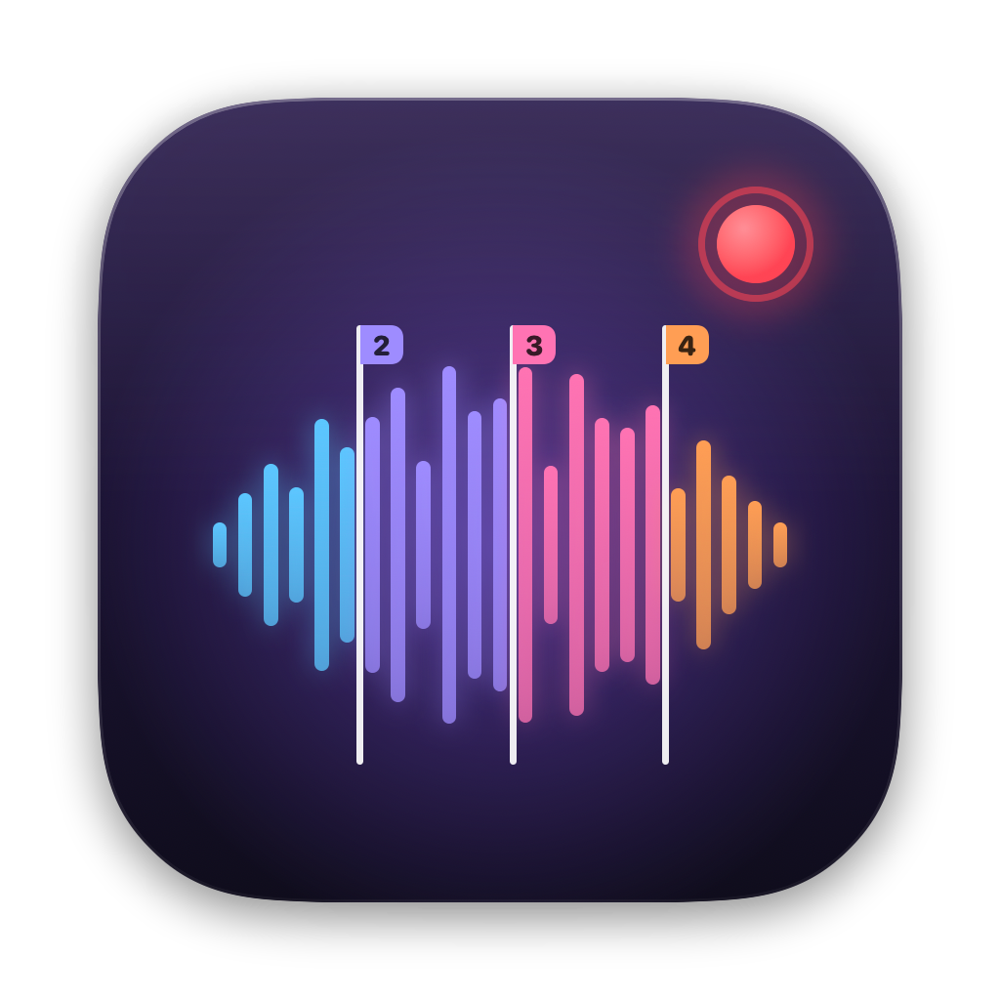
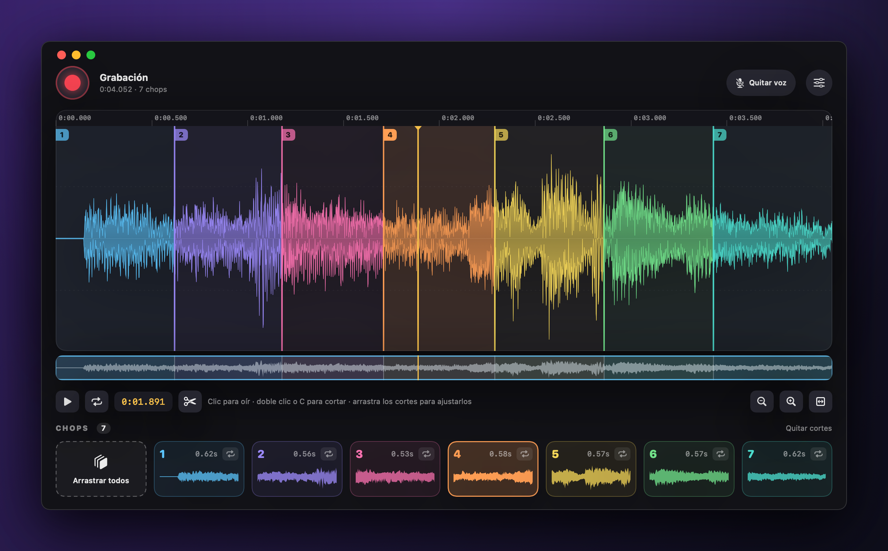

<p align="center">
  
</p>

<h1 align="center">Recorded</h1>

<p align="center">
  <b>Graba cualquier sonido de tu Mac, córtalo en chops y arrástralo directo a tu sampler.</b><br>
  Hecha para samplear desde YouTube, Spotify o cualquier app hacia Koala Sampler, tu DAW o el Finder.
</p>

<p align="center">
  
  
  
  
</p>

<p align="center">
  
</p>

---

## ✨ Qué hace

| | |
|---|---|
| 🎙️ **Graba el audio del sistema** | Todo lo que suena en el Mac, en 48 kHz / float 32 bits, sin cables ni drivers virtuales. |
| 👂 **Arranca sola** | Se arma y empieza a grabar en cuanto detecta audio (con pre-roll para no perder el ataque). Puede parar sola tras unos segundos de silencio. |
| ✂️ **Chops estilo Slicex** | Corta a mano con doble clic o al vuelo con la tecla **C** mientras suena. Cada chop tiene su color y su número. |
| 🔁 **Loop por chop** | Repite cualquier chop sin cortes para comprobar que encaja. |
| 🎤 **Quitar la voz con IA** | Separa voz e instrumental con [Demucs](https://github.com/facebookresearch/demucs) usando la GPU. Si la canción no tiene voz, lo detecta. |
| 🖐️ **Arrastrar y soltar** | Cada pad se arrastra como WAV a Koala Sampler, Ableton, Logic, FL Studio o el Finder. O todos a la vez. |
| 🔍 **Zoom fino** | Pellizco en el trackpad hasta ver las muestras individuales, para cortar justo donde quieres. |

## 🚀 Instalación

Necesitas **macOS 14.2 o posterior** y las **Command Line Tools** (no hace falta Xcode):

```bash
xcode-select --install   # solo si no las tienes
```

Clona, compila e instala:

```bash
git clone https://github.com/vargased94/recorded-app.git
cd recorded-app
./build.sh
cp -R build/Recorded.app /Applications/
```

Abre **Recorded** desde Aplicaciones y, si quieres, ánclala al Dock (clic derecho → Opciones → Mantener en el Dock).

> **Permiso de audio:** la primera vez que grabes, macOS pedirá permiso. Actívalo en **Ajustes del Sistema → Privacidad y seguridad → Grabación de pantalla y audio del sistema → Solo grabación de audio del sistema**, y vuelve a abrir la app.

### Opcional: quitar la voz

Instala Demucs una sola vez (~430 MB en `~/Library/Application Support/Recorded`):

```bash
./tools/setup-demucs.sh
```

## 🎛️ Cómo se usa

### 1. Graba

1. Pulsa el **botón rojo** (o **⌘R**). La app queda en *Esperando audio…*
2. Reproduce la canción en YouTube, Spotify o donde sea. La grabación empieza sola.
3. Pulsa otra vez para detener (o deja que pare sola tras el silencio, desde ⚙️ ajustes).

### 2. Corta tus chops

- **Clic** en la onda → la escuchas desde ese punto.
- Mientras suena, pulsa **C** al ritmo → corta en ese instante.
- **Doble clic** → añade un corte exacto donde haces clic.
- **Arrastra un corte** (por su línea o su pestaña numerada) para ajustarlo. Con **⇧** el movimiento es fino.
- **⌥ + clic** sobre un corte → lo borra.

### 3. Afina con zoom

<p align="center">
  
</p>

- **Pellizco** en el trackpad para acercar o alejar alrededor del cursor.
- **Dos dedos** en horizontal para desplazarte.
- La **mini vista** de abajo muestra toda la grabación: arrástrala para moverte, doble clic para ver todo.

### 4. Escucha, loopea y quita la voz

- **Clic en un pad** o teclas **1–9** → dispara el chop.
- Botón **🔁** del pad (o **L**) → lo repite en loop.
- **Quitar voz** → separa la voz con IA y deja el instrumental. Pulsa **Instrumental** para alternar con el original.

### 5. Arrástralo a tu sampler

Arrastra cualquier **pad** a Koala Sampler (o a tu DAW o al Finder) y suelta: se crea un WAV al momento. Con **Arrastrar todos** sueltas todos los chops de una vez.

## ⌨️ Atajos

| Tecla | Acción |
|---|---|
| **⌘R** | Grabar / detener |
| **Espacio** | Reproducir / parar |
| **Clic** · **Doble clic** | Oír desde ahí · cortar |
| **C** | Cortar en el cursor (también mientras suena) |
| **1–9, 0** | Disparar chops 1–10 |
| **L** | Loop del chop seleccionado |
| **← →** | Chop anterior / siguiente |
| **⌥← ⌥→** | Mover el corte 10 ms (con **⇧**, 1 ms) |
| **⌫** | Unir el chop con el anterior |
| **⌥ + clic** | Borrar un corte |
| **⌘+ ⌘- ⌘0** | Acercar · alejar · ver todo |
| **Esc** | Parar |

## 🎧 Consejos para samplear de YouTube

- Pon el **volumen del reproductor de YouTube al 100 %** (el volumen del Mac da igual).
- Desactiva **Volumen estable** en el ⚙️ del reproductor: comprime la dinámica y los golpes pierden pegada.
- Se graba **todo** lo que suena en el Mac: silencia notificaciones y otras pestañas.
- La calidad máxima es la de la fuente: YouTube ya viene comprimido. Si tienes el tema en mejor calidad, úsalo.

## ⚙️ Ajustes

Desde el botón ⚙️ (arriba a la derecha):

- **Empezar al detectar audio** y su **umbral** (-60 a -20 dB).
- **Parar tras silencio** (1–10 s): descarta el silencio final.
- **Exportar chops:** normalizar a -0,3 dB, fade de 0–20 ms en los bordes (evita clics) y WAV de 16 o 24 bits.

## 🔬 Calidad de audio

Recorded captura el audio con **Core Audio Process Taps**, antes del volumen del sistema y de los altavoces o auriculares. Medido con una señal de prueba (barrido de 20 Hz a 20 kHz):

- El nivel grabado es idéntico al original y no hay recortes ni huecos.
- La respuesta en frecuencia es plana (±0,01 dB entre 50 Hz y 15 kHz).
- Graba a la frecuencia nativa del tap (48 kHz) para evitar conversiones innecesarias.

Puedes repetir la prueba con:

```bash
build/Recorded.app/Contents/MacOS/Recorded --selftest /tmp/prueba.caf 8
```

## 🗂️ Estructura

```
Sources/Recorded/
├── SystemAudioRecorder.swift   Captura con Core Audio Process Taps, detección y auto-stop
├── WaveData.swift              Forma de onda multirresolución (mín/máx + muestras)
├── WaveformView.swift          Onda, cortes, zoom y mini vista general
├── ContentView.swift           Interfaz: barra superior, transporte y pads
├── AppModel.swift              Estado, chops, reproducción, exportación y Demucs
├── AudioTools.swift            Lectura, exportación WAV y reproductor
├── DragOut.swift               Arrastrar archivos a otras apps
└── TrackpadCatcher.swift       Pellizco y scroll del trackpad
tools/
├── setup-demucs.sh             Instala Demucs en un entorno aislado
├── separate.py                 Separación de voz (htdemucs)
└── icon/make-icon.swift        Genera el icono
```

## 🙏 Créditos

- Separación de voz: [Demucs](https://github.com/facebookresearch/demucs) (modelo `htdemucs`) de Meta AI, licencia MIT.
- Inspirada en el flujo de trabajo de Slicex y Koala Sampler.

> Recorded está firmada ad-hoc. Si al recompilar macOS te vuelve a pedir el permiso, crea un certificado de firma de código llamado **"Recorded Dev"** en Acceso a Llaveros: `build.sh` lo usará y el permiso se conservará.
